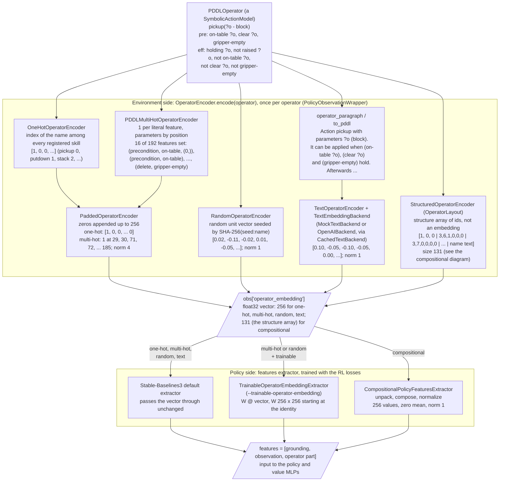
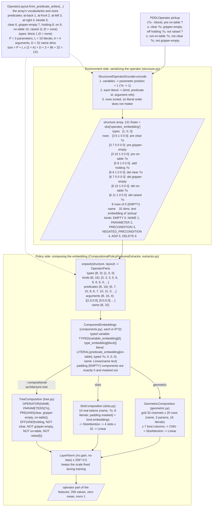

# Operator embeddings

How a PDDL operator becomes `obs["operator_embedding"]`, and how the policy turns that into the operator
part of its features, for every `--operator-encoder`. Each box names a class and shows its output for
the pickup operator below, computed with the default settings (`--operator-embedding-dim 256`,
`--max-operator-arity 3`, `--max-operator-literals 16`, `--max-predicate-arity 4`,
`--component-embedding-dim 32`, `--seed 0`). See `docs/policy_inputs.md` for the full observation.

```lisp
(:action pickup
    :parameters (?o - block)
    :precondition (and (on-table ?o) (clear ?o) (gripper-empty))
    :effect (and (holding ?o) (not (raised ?o)) (not (on-table ?o)) (not (clear ?o)) (not (gripper-empty))))
```

Two places do the work. In the environment, `PolicyObservationWrapper` calls an `OperatorEncoder` once
per operator and puts the result in the observation. In the policy, the features extractor (its first
module) turns that observation entry into the operator part of the MLP input. Only the extractor has
trainable parameters, so only that half changes during training.

## Overview: every encoder



What each condition gives the policy:

| condition | structure in the vector | learned | new or repaired operator |
| --- | --- | --- | --- |
| one-hot | none: an index | no | an index no training has used (or, with `--operator-identity-aliases`, the original's) |
| random | none: an identifier | no | a new vector for a new name (or, with `--operator-identity-aliases`, the original's) |
| random + trainable | none | a vector per operator (through W) | a new random vector, not trained |
| text | whatever the text model captures | no | a new text embedding |
| multi-hot | literal features, by parameter position | no | same feature space, new vector |
| multi-hot + trainable | literal features | a vector per feature (columns of W) | the sum of its features' vectors |
| compositional | the full operator, as a tree / tokens / grid | every component and composition function | composed from the same components |

## Identity: one-hot and random

`OneHotOperatorEncoder` is the baseline: one entry per operator, no structure.
It indexes every registered skill's operator in registry order (`SKILL_REGISTRY`),
so an operator keeps its index whatever the training skills, and a held-out
skill has an index no training run has used. `RandomOperatorEncoder` gives each
operator name a fixed random unit vector (seeded by SHA-256 of `seed:name`, so it
is the same in every process). Both identify operators by name: a changed
operator that keeps its name keeps its code.

`--operator-identity-aliases NEW=OLD` encodes NEW exactly as OLD (one-hot and
random only), so a repaired operator is indistinguishable from the original:
the repair-hidden control (`docs/research_focus.md`, RQ3). Content-based
encoders ignore it.

## Multi-hot: literal features

`PDDLMultiHotOperatorEncoder` gives each operator a vector over a fixed
vocabulary of literal features, with 1 where it has the feature and 0 where it
does not. A feature is a literal of one section, described two ways:

- **positional**: `(section, predicate, parameter positions)`, e.g.
  `("add", "on", (0, 1))` = "the object in parameter 0 ends up on the object in
  parameter 1". Variable names (`?o`, `?b`) are irrelevant; positions are canonical.
- **name only**: `(section, predicate)`, e.g. `("add", "on")`. Shared by more
  operators, so a held-out operator still activates features seen in training.

Sections: `precondition`, `negated_precondition`, `add`, `delete`.

Example over pickup and putdown, showing only the features they set
(positional features shown; each also sets the matching name-only feature):

| Feature | pickup `(?o)` | putdown `(?o)` |
|---|---|---|
| precondition `on-table`(0) | 1 | 0 |
| precondition `clear`(0) | 1 | 0 |
| precondition `gripper-empty`() | 1 | 0 |
| precondition `holding`(0) | 0 | 1 |
| add `holding`(0) | 1 | 0 |
| add `on-table`(0) | 0 | 1 |
| add `clear`(0) | 0 | 1 |
| add `gripper-empty`() | 0 | 1 |
| delete `on-table`(0) | 1 | 0 |
| delete `clear`(0) | 1 | 0 |
| delete `gripper-empty`() | 1 | 0 |
| delete `holding`(0) | 0 | 1 |
| delete `raised`(0) | 1 | 0 |

The vocabulary does **not** depend on the training operators. It is every
feature any operator could have, given the predicates the environment can
evaluate (Fetch: `FETCH_PREDICATE_ARITIES`) and a maximum operator arity
(`--max-operator-arity`, default 3):

    size = 4 sections x sum over predicates of (1 + max_arity! / (max_arity - arity)!)

For Fetch (11 predicates) that is 80 / 128 / 192 features for a maximum arity
of 1 / 2 / 3. `PaddedOperatorEncoder` appends zeros up to
`--operator-embedding-dim` (default 256), the size every encoder shares. So
training on n operators and testing on an (n+1)-th uses the same indices, and
an operator repaired by adding or removing preconditions or effects is simply
re-encoded: only the features of the changed literals move.

Operators the vocabulary cannot represent are rejected with `ValueError`
rather than partially encoded: more parameters than the maximum arity, a
predicate the environment cannot evaluate, a constant argument, or a repeated
parameter such as `(on ?x ?x)`.

## Compositional: from operator to embedding

The compositional condition splits the work differently. The observation holds the operator's
structure (`StructuredOperatorEncoder`), and the embedding is composed from it inside the policy
(`CompositionalPolicyFeaturesExtractor`). Code: `src/cam/representations/compositional/`.



Notes on the parts that are easy to misread:

- **The structure array is not an embedding.** It is a lossless, fixed-size serialization of the
  operator: integer ids stored as floats, plus the name's fixed text embedding. It sits in
  `obs["operator_embedding"]` only because that is where every condition puts its operator input.
  The actual embedding exists only inside the policy.
- **Ids start at 1; 0 means "nothing".** Predicate and type ids are their vocabulary index + 1,
  argument refs are parameter position + 1, and the kind `EMPTY = 0` marks unused rows. That is why
  `?o` is 1 in the array but `variable_embedding[0]` in the policy.
- **Variables are positions.** `?o` and `?x` in the same position give the same array, and argument
  ref `i` matches grounding slot `i` in `obs["grounding"]`.
- **`OperatorLayout` is shared.** The encoder writes the array and `unpack` reads it with the same
  layout. Its maxima are settings, not derived from the current operators, so new or repaired
  operators fit the same array.
- **With `--compositional-name none`**, D = 0, the array is 99 long, and no name component is built.
